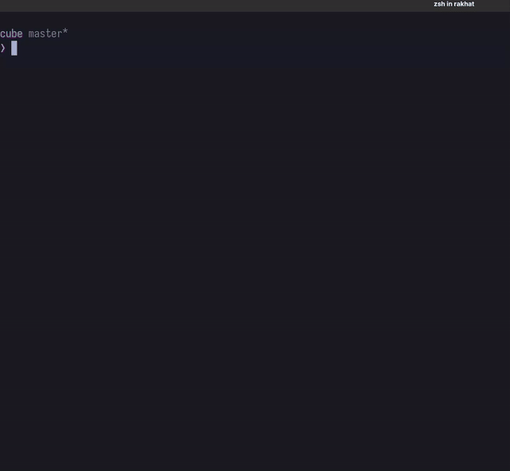

# Rotating ASCII Cube

A 3D cube that spins in the terminal, drawn in ASCII with ANSI colors.

**Status: runs.**



Each frame, the program samples points on the six faces of a cube. It rotates
them about all three axes, then projects them onto the screen. A z-buffer keeps
only the point nearest the camera in each cell. Each face gets its own shade,
from the 256-color range 46 to 51.

## Usage

```sh
cargo run
```

The cube turns at a random speed. Press `Ctrl+C` to stop.

With devenv, run `devenv shell` first. It provides the Rust toolchain.

## Configuration

`main.rs` sets the values. Change them there:

| Call | Effect |
| --- | --- |
| `Cube::new(30, 80, 15)` | Screen of 30 rows by 80 columns. The cube reaches 15 units from its center. |
| `cube.random_rotation()` | Picks a new speed for each axis every step, from 0 to 0.20. |
| `cube.set_speed(x, y, z)` | Fixed speed per axis. The default is `0.07, 0.07, 0.1`. |
| `cube.set_initial_rotation(x, y, z)` | Start angles, in radians. |

The frame time is 33 ms, set in `Cube::run`.

## Known Issues

- The rotation speed is also the step size for sampling the faces. A small
  speed makes each frame slow. A speed of 0 never ends the sampling loop, so
  the program hangs.
- The terminal must be at least 80 columns wide and 31 rows tall. If it is
  smaller, lines wrap and the image breaks.

## License

[MIT](../LICENSE) © 2024-2026 Rakhat Yskak
