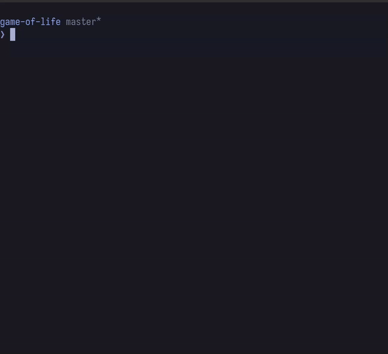

# Game of Life

Conway's Game of Life, drawn in the terminal with ANSI colors.

**Status: runs.**



The Game of Life is a cellular automaton that John Horton Conway devised in
1970. Each cell is alive or dead. On every tick, all cells update at once:

- A live cell with 2 or 3 live neighbours stays alive. Otherwise it dies.
- A dead cell with exactly 3 live neighbours comes alive.

It is a zero-player game. The first state decides everything that follows.

## Usage

```sh
cargo run
```

The program places cells at random and then runs the game. Each frame shows
the seed, the tick count and the population. Live cells are green and dead
cells are white. The game stops when no cells are left. Press `Ctrl+C` to stop
it sooner.

With devenv, run `devenv shell` first. It provides the Rust toolchain.

## Configuration

`src/main.rs` sets the values. Change them there:

| Value | Default | Meaning |
| --- | --- | --- |
| `seed` | `1337` | Seed for the random start. The same seed gives the same game. |
| `population` | `75` | Number of live cells at the start |
| `height`, `width` | `15`, `20` | Grid size in cells |

The tick time is 33 ms, set in `Conway::run` in [`src/conway.rs`](src/conway.rs).

## Known Issues

- The edges do not wrap. Cells beyond the edge count as dead.
- A pattern that never dies out, such as a still life, runs forever.
- `population` must not be larger than `height × width`, or
  `random_generation` never finishes.
- Each tick copies the next grid instead of swapping the two buffers.

## License

[MIT](../LICENSE) © 2024-2026 Rakhat Yskak
